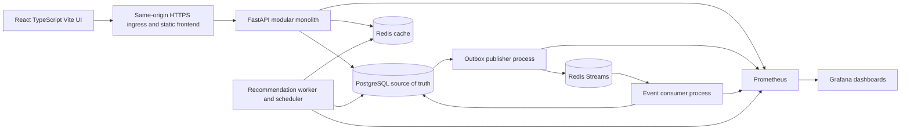
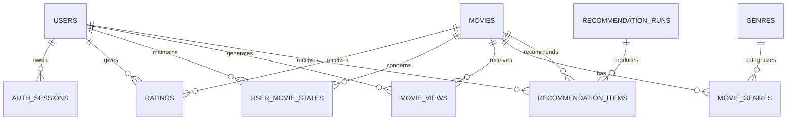
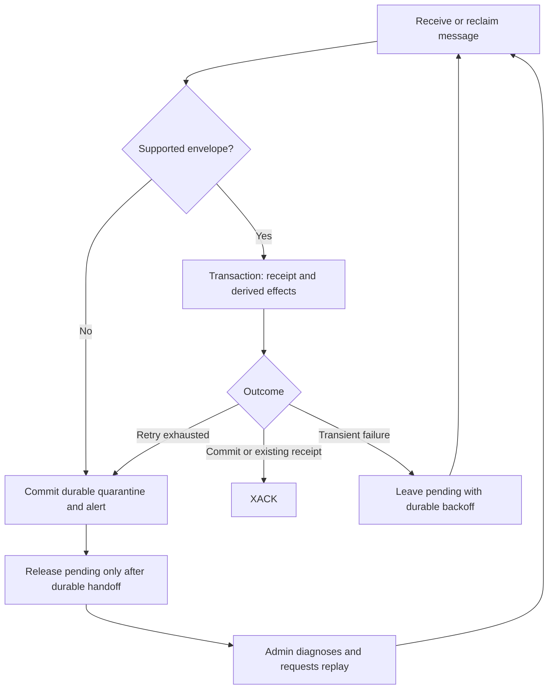

# Technical architecture

Status: Phase 0 target blueprint with Phase 1 local foundation implemented. API.md and DEPLOYMENT.md distinguish current behavior from future targets. No business modules, workers or recommendation code exist yet.

Phase 1 operational amendment: `/health` is the canonical liveness route with `/health/live` as an alias. `/health/ready` checks both PostgreSQL and Redis; schema compatibility and Redis-degraded readiness are deferred. Local Compose has four services only. Nginx serves the compiled SPA and proxies `/api/*`; TLS and public ingress hardening are deferred.

Phase 2 database amendment: [DATABASE.md](DATABASE.md) is authoritative for the implemented twelve-table schema and ERD. Users use UUID and movies use BIGINT identities. Separate user_favorites/watchlists, processed_events, refresh_tokens and per-user replacement recommendations supersede the corresponding physical-table sketches below. Snapshot runs, jobs, watched state and audit/recovery tables remain future migrations. No API, worker or algorithm is implemented by adding schema. Phase 1 audit remediation remains open.

## System structure



All backend processes share a versioned codebase, models and migrations. One PostgreSQL database owns transactional state. Redis uses separate logical namespaces/connections for cache and streams; stream keys must not be evicted. A dedicated Redis instance for streams is preferred when cache eviction is needed. Cache loss never loses authoritative state.

Frontend: React Router owns navigation; TanStack Query owns remote state and invalidation; Zustand holds transient UI state only; Axios handles transport and coordinated session refresh. Tailwind/shadcn/ui implement interface components; Recharts renders analytics. Never persist access tokens in browser storage.

## Module ownership and layering

| Module | Owns | Dependencies and boundary |
| --- | --- | --- |
| Auth | Credentials/session lifecycle, authentication dependencies | Users identity/status; never accepts caller-selected roles |
| Users | Profile, roles and status | Auth revocation service for account changes |
| Movies | Catalog metadata and availability | Genres assignment interface |
| Genres | Genre vocabulary | Rejects deletion while assigned |
| Interactions | Views, watched/favorite/watchlist state | Active Movies and Users validation |
| Ratings | Current explicit ratings | Active Movies and Users validation |
| Recommendations | Jobs, generation, ranking and result snapshots | Read-only catalog/ratings/interactions queries |
| Events | Outbox, publishing, receipts, recovery and quarantine | Shared transaction-aware event writer |
| Analytics | Personal/system aggregates and projection handlers | Read-only source queries; no ownership of ratings |
| Admin | Authorized administration orchestration and audit | Calls owning module services; does not duplicate catalog/user logic |

Each module separates routers, schemas, services, repositories and models. Routers validate transport and call services through dependency injection. Services own use cases and transaction boundaries; repositories execute SQLAlchemy queries without independent commits. A state mutation and outbox insertion share one SQLAlchemy transaction. Cross-module reads use explicit query/service interfaces; avoid circular imports and generic repository frameworks.

## API contract outline

All routes use `/api/v1`; this is a proposed contract for later OpenAPI implementation. JSON errors contain `code`, safe `message`, optional field `details`, and `request_id`. Use 400 for semantic errors, 401 unauthenticated, 403 unauthorized, 404 absent/inaccessible resources, 409 conflicts, 422 schema validation, 429 throttling and 503 unavailable dependencies. Lists return `items`, `page`, `page_size`, `total`; deterministic ordering includes ID tie-breakers.

| Module | Routes | Access |
| --- | --- | --- |
| Auth | POST `/auth/register`, `/auth/login`, `/auth/refresh`, `/auth/logout`; GET `/auth/csrf` | Public registration/login; refresh/logout cookie+CSRF; CSRF bootstrap same-origin |
| Users | GET/PATCH `/users/me`; PUT `/users/me/password` | Authenticated owner |
| Movies | GET `/movies`, `/movies/{id}` | Public, active only |
| Genres | GET `/genres` | Public |
| Interactions | POST `/movies/{id}/views`; PUT/DELETE `/movies/{id}/watched`, `/favorite`, `/watchlist`; GET `/users/me/watched`, `/favorites`, `/watchlist` | Authenticated owner |
| Ratings | PUT/DELETE `/movies/{id}/rating`; GET `/users/me/ratings` | Authenticated owner |
| Recommendations | GET `/users/me/recommendations` | Authenticated owner; includes method, generation time and fallback reason |
| Analytics | GET `/users/me/statistics` | Authenticated owner |
| Admin catalog | GET/POST `/admin/movies`; GET/PATCH `/admin/movies/{id}`; POST/PATCH/DELETE `/admin/genres[/{id}]` | ADMIN; deletion applies only to genre by ID; movie PATCH deactivates |
| Admin users | GET `/admin/users`; PATCH `/admin/users/{id}/status`, `/role` | ADMIN with last-admin invariant |
| Admin operations | GET `/admin/statistics`, `/admin/events`, `/admin/recommendation-runs`; POST `/admin/events/{event_id}/replay`, `/admin/recommendation-runs` | ADMIN; triggers return 202 with job ID |
| Operations | GET `/health/live`, `/health/ready`; GET `/metrics` | Health minimal; metrics internal only |

PUT/DELETE state operations return the resulting state/204 and emit events only on actual changes. View POST requires a client-generated request UUID, unique per user; retries reuse that UUID. Views are authenticated, deduplicated telemetry, never explicit ratings. Concurrent rating/state writes serialize per user/movie using a stable interaction revision row lock, so event revisions reflect commit order. Admin edits use a resource version and reject stale updates with 409.

## Database blueprint

The following is the original Phase 0 target sketch, retained for design history. Use DATABASE.md for current keys/types, constraints and entities; do not generate migrations from this sketch. Foreign keys/indexes are required and every schema change uses Alembic.

| Entity | Main attributes and integrity rules |
| --- | --- |
| users | normalized_email UNIQUE, password_hash, display_name, role USER/ADMIN, status active/suspended, timestamps |
| auth_sessions | user_id FK, family_id, current token hash UNIQUE, expiry, revoked_at; index user_id; token history records consumed hashes for reuse detection |
| movies | title, synopsis, release_year, runtime_minutes, poster_url, optional source/external_id UNIQUE pair, is_active, version; year/runtime checks; title and filter indexes |
| genres / movie_genres | unique normalized genre name; join composite PK(movie_id, genre_id); both FKs and reverse genre index |
| ratings | composite UNIQUE(user_id,movie_id), value CHECK 1–5, timestamps; index movie_id for aggregation |
| user_movie_states | composite PK(user_id,movie_id), watched/favorite/watchlist booleans, revision, updated_at; persistent lock/revision anchor shared with ratings; false states retained for ordering |
| movie_views | user_id, movie_id FKs, request_id, viewed_at; UNIQUE(user_id,request_id); date/movie/user indexes |
| outbox_events | event_id PK, type, schema_version, aggregate_key/revision, JSON payload, occurred_at, published_at, publish_attempts, next_attempt_at, lease expiry, last_error; eligible-publish index |
| event_receipts | composite PK(consumer_group,event_id), processed_at; same transaction as derived writes |
| event_failures / replay_jobs | group/event UNIQUE failure state, attempts, next_attempt_at, sanitized error, quarantine status; replay job operator/status/timestamps; original payload remains in outbox |
| consumer_projections | consumer-owned analytics or invalidation state keyed by user/movie; last applied revision where state events apply; never replaces authoritative ratings/state |
| recommendation_jobs | unique active job key, trigger, status, requested_by, lease/heartbeat, retry count; durable scheduling and restart recovery |
| recommendation_runs | algorithm/config version, source cutoff, started/finished_at, status/error, counts, coverage; linked job |
| recommendation_items | run_id,user_id,movie_id, rank, method, nullable predicted_rating/popularity_score, reason; UNIQUE(run,user,movie), UNIQUE(run,user,rank) |
| active_recommendation_run | singleton pointer to a successful run, switched atomically after full generation |
| admin_audit_logs | actor FK, action, target, safe summary, request_id, created_at; restricted append-only application access |



Outbox aggregate IDs are logical references to multiple entity types, not polymorphic foreign keys. Event receipts/failures reference outbox event IDs. Account and movie removal is restricted in MVP; deactivation preserves referenced history. No destructive cascade of events or audit data.

## Event lifecycle and reliability

```mermaid
sequenceDiagram
    participant UI
    participant API
    participant DB as PostgreSQL
    participant Pub as Publisher
    participant RS as Redis Stream
    participant W as Consumer group worker
    UI->>API: Rate or update collection
    API->>DB: BEGIN, lock revision, write state + outbox
    DB-->>API: COMMIT
    API-->>UI: Success
    Pub->>DB: Claim eligible rows with expiring lease
    Pub->>RS: XADD original event UUID and envelope
    RS-->>Pub: Stream entry ID
    Pub->>DB: Record publish success
    W->>RS: XREADGROUP
    W->>DB: BEGIN; insert receipt and update projection
    DB-->>W: COMMIT
    W->>RS: XACK only after committed success
```

Envelope: `event_id`, `event_type`, `schema_version`, `occurred_at`, `aggregate_key`, `aggregate_revision`, `actor_id`, `correlation_id`, and minimal `payload`. No credentials or unnecessary personal data. State events contain resulting state and revision; rating removal includes a null rating. Initial types: `movie.viewed`, `rating.changed`, `watched.changed`, `favorite.changed`, `watchlist.changed`, `movie.changed`, `genre.changed`, `user.status_changed`. Catalog genre assignments are included in movie changes. Recommendation jobs/runs have durable status; metrics need not become domain events.

- Publisher claims short batches using PostgreSQL row locks with SKIP LOCKED and commits a renewable lease before network I/O. XADD precedes published marking. A crash between these steps creates duplicates; consumers deduplicate by event UUID, never Redis entry ID. Expired leases are recoverable. PostgreSQL outages prevent claiming/marking; Redis failures leave rows retryable.
- MVP uses one stream `cinematch:events:v1` and consumer group `derived-state-v1`. Its handler transaction updates analytics projections and marks recommendation inputs dirty. Add independently tracked groups only when there is a real additional consumer. Consumers cannot assume global or per-aggregate delivery order; stale revisions cannot overwrite newer state. View counts use UUID receipts for exact deduplication of each retained event.
- Receipt uniqueness is claimed inside the same transaction as effects. A duplicate receipt is a successful no-op, then acknowledged. Failures roll back both. External side effects require their own outbox; do not perform them inside the consumer transaction.
- Read new entries with XREADGROUP; periodically reclaim stale pending messages with XAUTOCLAIM. Initial idle threshold 60 seconds, heartbeat every 15 seconds and bounded handler work under 30 seconds; tune after load tests. Durable retry metadata lives in PostgreSQL. Backoff starts at 1 second, doubles with jitter, caps at 60 seconds, and quarantines after 10 processing failures. Dependency outages pause processing without burning poison-message retries.
- Quarantine records original event ID, group, attempts and safe error before removing a poison entry from pending. This is a durable failed-processing handoff, not successful processing; dashboard/alerts keep it unresolved until replay succeeds. If quarantine cannot commit, never acknowledge. Unsupported schema versions quarantine explicitly. Replay jobs republish the same event UUID; an uncommitted/failed handler has no success receipt. Replaying an already processed event remains a no-op; rebuilding a projection requires a new consumer version and isolated state.
- Published does not mean processed. A reconciler compares retained outbox UUIDs to required-group receipts and durable failures, and republishes missing work after a grace period (initially 5 minutes). After Redis loss it recreates stream/groups and replays missing UUIDs. Publisher success alone never permits deletion. Redis AOF and persistent volumes help availability but do not replace PostgreSQL recovery.
- MVP keeps all outbox rows and receipts, with disk/backlog alerts. No automatic trimming or pruning until a tested retention protocol proves required groups have completed each event and replay/backup requirements are met. This costs storage and is a documented MVP limitation.
- Cache entries have bounded TTLs (catalog 60 seconds, recommendation response 60 seconds), versioned keys and best-effort invalidation after commits. Reads recheck current movie availability and user eligibility against PostgreSQL, so stale caches never expose deactivated movies or already-watched recommendations. Admin suspension/session checks bypass stale cache.



## Recommendation specification

Only current explicit 1–5 ratings supply collaborative similarity. Views/favorites/watchlist are not converted into invented ratings. Watched status excludes candidates; favorites may supply a secondary tie-break only. Popularity uses current rating evidence:

`popularity(i) = (v_i * R_i + m * C) / (v_i + m)`

Here `v_i` is rating count, `R_i` mean rating, `C` global mean and `m=10` is an initial configurable prior weight. An unrated movie uses C only when global ratings exist. With no ratings anywhere, scores are null and deterministic fallback sorts active movies by release year descending then ID, labeled `catalog_fallback`. Never display this order as a calculated preference score.

Collaborative filtering uses a sparse user-rating matrix. Center each observed rating by that user's mean. Missing ratings remain missing. For users u and v, cosine similarity uses centered vectors restricted to co-rated items; require at least 3 co-ratings and nonzero norms, discard nonpositive similarities, and choose Top-K=20 eligible neighbors per target item (ties by user ID). Initial parameters are configurable and recorded per run.

`prediction(u,i) = mean(u) + sum(sim(u,v) * (rating(v,i) - mean(v))) / sum(abs(sim(u,v)))`

Require at least 2 contributing neighbors; clamp predictions to [1,5]. Users need at least 5 current ratings to attempt collaborative filtering. Insufficient evidence/zero denominator falls back to popularity. Cold-start users, sparse movies and newly added movies follow the same explicit fallback rules.

Ranking: filter inactive/watched/rated movies, sort supported collaborative candidates by prediction, similarity support then movie ID; fill remaining slots from popularity ordered by calculated value, rating count then ID. Do not compare null catalog fallback scores to predicted scores or fabricate a combined numeric score. Return a method/reason per item. Favorites can break equal-score ties using favorite genre overlap; this is a documented rule, not a learned prediction. Already-favorited or watchlisted movies remain eligible unless watched/rated.

Runs use a consistent PostgreSQL snapshot and record its cutoff. A single leased job generates results in bounded batches, writes an unpublished run, then atomically switches the successful-run pointer. Snapshot reads must not hold a transaction for unbounded computation: export immutable input to worker memory within a bounded read transaction, release it, then compute. Failed runs never activate partial results. Scheduler inserts a durable generation job every 15 minutes; dirty state allows skipping unchanged inputs, and an hourly full refresh reconciles missed invalidations. Admin triggers coalesce with active jobs. Eligibility is checked again at read time; if stored candidates are exhausted, use current popularity.

Evaluate on a temporal per-user holdout with enough prior ratings: Precision@10/Recall@10 for held-out ratings ≥4, coverage, fallback rate and prediction MAE on supported held-out explicit ratings. Exclude held-out data from global means, similarities and ranking. Compare against popularity; report sample counts and sparse-data limitations. No quality improvement is promised without measurement. Batch user-based pairwise comparison may not meet the target dataset budget; benchmark sparse operations before introducing optimizations or changing scale targets.

## Deployment and operations

Docker Compose initially runs frontend static serving/ingress, API, outbox publisher, event consumer, recommendation worker/scheduler, PostgreSQL, Redis, Prometheus and Grafana on one host. API/worker containers use the same backend image with different commands. An ingress/static server is an ancillary infrastructure dependency, selected in the deployment phase with rationale; no application framework change is implied.

Only HTTPS ingress is public. PostgreSQL, Redis and internal metrics stay on private networks; Grafana requires operator authentication. Use durable PostgreSQL/Redis volumes, persistent metrics as budget allows, explicit CPU/memory limits, health checks and restart policies. Liveness indicates process health; API readiness requires PostgreSQL and schema compatibility, while Redis degradation is reported separately because durable writes can proceed without it. Worker readiness requires its dependencies. A single host remains a single failure domain.

Deployment order: back up PostgreSQL → run one controlled Alembic migration job → start compatible API/workers → check readiness → execute smoke journeys. Migrations must be reviewed for locks and backward compatibility; never run migrations independently in every replica. Roll back application images only when schema-compatible; restore or forward-fix destructive migrations using an explicit operator procedure. Never assume a downgrade is lossless.

Monitor outbox oldest age >60 seconds for 5 minutes, quarantine count >0 immediately, no worker heartbeat >60 seconds, event p95 lag >30 seconds for 5 minutes, recommendation success age >30 minutes, sustained HTTP 5xx >1%, and storage >80%. These initial alert thresholds need load-based tuning. Restore PostgreSQL into an isolated environment, verify user/catalog/interaction counts and outbox reconciliation, then time service recovery against the proposed RPO/RTO. Redis can be rebuilt from retained source data and outbox.

## Future documentation decomposition

This Phase 0 blueprint contains the initial database, API, event, recommendation and deployment contracts. Future implementation phases will expand these into `DATABASE.md`, `API.md`, `EVENT_FLOW.md`, `RECOMMENDATION.md` and `DEPLOYMENT.md` with actual schemas, OpenAPI examples, commands and verified operational procedures. Those files are not represented as implemented deliverables now.
