# PostgreSQL schema — through Phase 6

Status: schema revisions 0001 and 0002 implemented; verification evidence is recorded in DEVELOPMENT_PROGRESS.md. This document is the implemented database contract. Authentication, catalog and interaction APIs use this schema; workers and recommendation algorithms remain future phases.

## Design and ownership

PostgreSQL 17 is the source of truth. SQLAlchemy 2 models live in backend/app/models/, grouped by module ownership: users, catalog, interactions, events, recommendations and auth. The explicit __init__ registry loads every model into Base.metadata for Alembic. Common mixins provide timestamps, not generic business repositories or automatic commits. Foreign keys are defined without eager ORM collection relationships, avoiding hidden loading/cascades before real use cases exist.

Initial revision: `0001_initial_schema`, file `backend/alembic/versions/0001_initial_schema_initial_cinematch_schema.py`. Migration operations contain immutable schema definitions rather than importing current models or calling create_all. Stable constraint names come from Base.metadata naming conventions. No PostgreSQL extension is needed: gen_random_uuid() is available in the supported PostgreSQL version.

- Users use UUID PKs, generated server-side when omitted. Movie IDs use BIGINT GENERATED BY DEFAULT AS IDENTITY, supporting optional explicit seed/import IDs. Genres and movie-view IDs also use BIGINT identities. Every movie FK uses BIGINT; every user FK uses UUID.
- All timestamps are TIMESTAMPTZ with database now() defaults where appropriate. Values represent instants; presentation timezone belongs to the client. created_at remains stable during rating updates. updated_at uses SQLAlchemy onupdate=now() for SQLAlchemy updates. Raw SQL and PostgreSQL ON CONFLICT updates must explicitly set updated_at; no database update trigger is installed.
- JSONB appears only in outbox payload. Relational identities, token lifecycle, recommendation provenance and values remain typed columns. Payload must be a non-null JSON object; no JSONB index is created because processing reads by event/aggregate identity rather than payload search.
- Composite keys encode uniqueness directly; favorites, watchlists and ratings do not carry redundant surrogate IDs. Movie rating counts/averages, genre counts, passwords in plaintext, raw refresh tokens and duplicate user/movie metadata are not stored.

## Entities and constraints

| Entity | Key and columns | Database-enforced integrity |
| --- | --- | --- |
| users | id UUID; email VARCHAR(320); password_hash TEXT; display_name VARCHAR(100); role/status; interaction_version BIGINT default 0; created_at/updated_at | Unique email; lowercase/trimmed email length 3–320; nonblank display name; nonempty hash; role USER/ADMIN; status active/suspended; interaction_version >=0; ordered timestamps |
| movies | id BIGINT identity; title, optional synopsis/release_year/runtime_minutes/poster_url; is_active; version; timestamps | Nonblank title ≤255; known year 1888–9999; known runtime >0; version >0; ordered timestamps; unknown year/runtime remain NULL |
| genres | id BIGINT identity; name VARCHAR(80); timestamps | Trimmed nonblank name; unique lower(name) expression index; ordered timestamps |
| movie_genres | PK(movie_id, genre_id) | Both FKs; duplicate assignment impossible |
| ratings | PK(user_id, movie_id); value NUMERIC(3,2); timestamps | Both FKs; decimal 0.50–5.00; one current rating per pair; ordered timestamps |
| movie_views | id BIGINT identity; user_id/movie_id; request_id UUID; viewed_at | Both FKs; UNIQUE(user_id, request_id) deduplicates a retried client visit while allowing future visits |
| user_favorites | PK(user_id, movie_id); created_at | Both FKs; at most one favorite per pair |
| watchlists | PK(user_id, movie_id); created_at | Both FKs; at most one watchlist entry per pair; separate from favorites |
| outbox_events | id UUID; event_type; schema_version; aggregate_type/id/version; payload JSONB; occurred_at/published_at; publish_attempts; next_attempt_at/lease_expires_at; last_error | Nonblank event/aggregate identity; positive schema/aggregate versions; attempts ≥0; object payload; publication cannot precede occurrence |
| processed_events | PK(consumer_group, event_id); processed_at | Nonblank consumer; FK event_id; same UUID may be processed once by each consumer group |
| recommendations | PK(user_id, movie_id); rank; method; nullable predicted_rating/popularity_score NUMERIC(6,5); algorithm_version; source_cutoff/generated_at | Both FKs; unique(user_id, rank); positive rank; nonblank algorithm version; generation ≥cutoff; method/score consistency below |
| refresh_tokens | id UUID; user_id; family_id UUID; token_hash VARCHAR(64); created_at/expires_at/consumed_at/revoked_at | User FK; unique lowercase 64-hex token hash; expiry >creation; consumption/revocation cannot precede creation |

Non-optional attributes are NOT NULL; only explicit optional metadata, scores and lifecycle timestamps are nullable. String enums use named CHECK constraints to keep migrations simple. Full email/URL validation, actual password hashing, last-admin invariants and availability/ownership checks require future services; the schema does not pretend to implement them.

## ERD

```mermaid
erDiagram
    USERS {
        uuid id PK
        varchar email UK
        text password_hash
        varchar role
        varchar status
        bigint interaction_version "nonnegative event sequence"
        timestamptz created_at
        timestamptz updated_at
    }
    MOVIES {
        bigint id PK
        varchar title
        smallint release_year
        boolean is_active
        integer version
    }
    GENRES {
        bigint id PK
        varchar name "unique lower(name)"
    }
    MOVIE_GENRES {
        bigint movie_id PK,FK
        bigint genre_id PK,FK
    }
    RATINGS {
        uuid user_id PK,FK
        bigint movie_id PK,FK
        numeric value "0.50 to 5.00"
        timestamptz updated_at
    }
    MOVIE_VIEWS {
        bigint id PK
        uuid user_id FK
        bigint movie_id FK
        uuid request_id "unique with user_id"
        timestamptz viewed_at
    }
    USER_FAVORITES {
        uuid user_id PK,FK
        bigint movie_id PK,FK
        timestamptz created_at
    }
    WATCHLISTS {
        uuid user_id PK,FK
        bigint movie_id PK,FK
        timestamptz created_at
    }
    OUTBOX_EVENTS {
        uuid id PK
        varchar event_type
        varchar aggregate_type
        varchar aggregate_id
        bigint aggregate_version
        jsonb payload
        timestamptz occurred_at
        timestamptz published_at
    }
    PROCESSED_EVENTS {
        varchar consumer_group PK
        uuid event_id PK,FK
        timestamptz processed_at
    }
    RECOMMENDATIONS {
        uuid user_id PK,FK
        bigint movie_id PK,FK
        integer rank "unique with user_id"
        varchar method
        numeric predicted_rating
        numeric popularity_score
        timestamptz generated_at
    }
    REFRESH_TOKENS {
        uuid id PK
        uuid user_id FK
        uuid family_id
        varchar token_hash UK
        timestamptz expires_at
        timestamptz consumed_at
        timestamptz revoked_at
    }
    USERS ||--o{ RATINGS : gives
    MOVIES ||--o{ RATINGS : receives
    MOVIES ||--o{ MOVIE_GENRES : has
    GENRES ||--o{ MOVIE_GENRES : assigns
    USERS ||--o{ MOVIE_VIEWS : records
    MOVIES ||--o{ MOVIE_VIEWS : receives
    USERS ||--o{ USER_FAVORITES : maintains
    MOVIES ||--o{ USER_FAVORITES : appears_in
    USERS ||--o{ WATCHLISTS : maintains
    MOVIES ||--o{ WATCHLISTS : appears_in
    USERS ||--o{ RECOMMENDATIONS : receives
    MOVIES ||--o{ RECOMMENDATIONS : appears_in
    USERS ||--o{ REFRESH_TOKENS : owns
    OUTBOX_EVENTS ||--o{ PROCESSED_EVENTS : acknowledged_by_consumer
```



Outbox aggregate_type/id is a logical reference across entity types, intentionally without a polymorphic FK. It preserves durable events independently of source-row deletion. family_id groups refresh-token rotations; it is a logical session identifier, not an FK to a nonexistent sessions table. Future auth code must enforce stable family ownership, serialize rotation, retain consumed hashes for reuse detection and revoke families. No session service is implemented yet.

## Delete behavior

| Relationship | ON DELETE | Reason |
| --- | --- | --- |
| ratings/movie_views/recommendations → users/movies | RESTRICT | Retain explicit preferences, telemetry and recommendation evidence; normal operations suspend users/deactivate movies |
| movie_genres → movies | CASCADE | Assignment has no independent life if an otherwise unreferenced movie is deliberately removed |
| movie_genres → genres | RESTRICT | Prevent silent removal of assigned genres |
| user_favorites/watchlists → users/movies | CASCADE | Disposable collection membership; historical tables still restrict deletion when present |
| refresh_tokens → users | CASCADE | Credentials cannot outlive deletion of their owner |
| processed_events → outbox_events | RESTRICT | Prevent pruning events with retained idempotency receipts |

No cascade deletes outbox events or receipts. No automatic pruning/deletion endpoint exists. Future account erasure and retention policies require explicit migrations/services. Cascades are enforced by PostgreSQL, not hidden ORM delete behavior.

## Indexes by expected query

PostgreSQL already indexes every PK and UNIQUE constraint. Those indexes are not duplicated manually. There are **21 explicit indexes**, including the unique genre expression index; the initial schema also has 12 PK and 4 UNIQUE-constraint indexes (37 application indexes total, excluding Alembic).

| Explicit index | Expected query / reason |
| --- | --- |
| uq_genres_name_lower | Case-insensitive genre uniqueness and exact lookup |
| ix_movies_active_year | Active catalog by release year DESC NULLS LAST, id; year filter |
| ix_movies_active_title_prefix | Active lower(title) prefix search with text_pattern_ops, id tie-break |
| ix_movie_genres_genre_movie | Genre filter → movie IDs; reverse side of join PK |
| ix_ratings_movie_user | Rating aggregates/collaborative item reads; reverse FK lookup |
| ix_ratings_user_updated | User ratings ordered by updated_at DESC, movie_id |
| ix_movie_views_user_time | User viewing history by viewed_at DESC, id |
| ix_movie_views_movie_time | Per-movie views/time ranges and reverse FK lookup |
| ix_movie_views_time | System time-window analytics without a user/movie filter |
| ix_user_favorites_user_created | User favorites by created_at DESC, movie_id |
| ix_user_favorites_movie | Reverse FK lookup and per-movie favorite counts |
| ix_watchlists_user_created | User watchlist by created_at DESC, movie_id |
| ix_watchlists_movie | Reverse FK lookup and per-movie watchlist counts |
| ix_outbox_events_pending | Partial published_at IS NULL, next_attempt_at/occurred_at/id; due publisher batches |
| ix_outbox_events_aggregate | Aggregate lookup and version ordering |
| ix_outbox_events_occurred | Chronological replay/backlog scans, stable id tie-break |
| ix_processed_events_event | Reverse FK lookup and event-centric reconciliation across groups |
| ix_recommendations_movie | Reverse FK lookup; user/rank reading already uses UNIQUE(user_id, rank) |
| ix_refresh_tokens_user | Logout-all/suspension/password-change revocation |
| ix_refresh_tokens_family | Rotation reuse response / family revocation |
| ix_refresh_tokens_expires | Expiry cleanup candidate queries |

Other index-backed paths: users.email for login, ratings/user/movie and collection pair PKs for idempotent state mutation, movie_views user/request uniqueness for retries, refresh token_hash uniqueness for authentication, processed_events group/event PK for deduplication.

The title B-tree serves a normalized prefix LIKE query, **not** arbitrary substring ILIKE '%term%'. Substring/token search remains a later catalog-phase decision; it would need a justified PostgreSQL search index/migration. Movie popularity is derived from ratings and has no fabricated/stale cached score column. Aggregate/recommendation workloads may scan source ratings; indexes alone do not promise the Phase 0 load targets. No benchmark or planner-choice guarantee is claimed.

## Transaction contracts supported by the schema

### Ratings and outbox

One pair has one current rating. Update or PostgreSQL ON CONFLICT DO UPDATE replaces value, preserves created_at and sets updated_at explicitly. In the same transaction, append an outbox event containing the resulting value and an original stable UUID. A rollback removes both business change and event. Rating deletion/change services and aggregate version allocation/locking arrive in their later phase. The schema checks positive versions; it does not assign or guarantee per-aggregate event ordering.

### Event idempotency

Future consumers insert (consumer_group, event_id) and derived effects in **one transaction**. A duplicate key or ON CONFLICT DO NOTHING identifies already committed work. A handler failure rolls back receipt and effects, permitting retry. Different groups can each process the same event UUID. Only acknowledge Redis after commit; this schema does not implement delivery, retries, pending recovery or exactly-once delivery. A transactional outbox works only when future services actually write business state and event together.

### Recommendation replacement

The current schema keeps one recommendation set per user, with no history table. Compute candidates before opening the write transaction; lock the user's users row to serialize concurrent replacements; DELETE that user's old rows and INSERT the new set in one transaction. Failure preserves the previous committed set. Unique user/rank and user/movie prevent duplicated ranks/movies. This replacement contract supersedes the earlier snapshot-run proposal for this foundation; historical runs/jobs require later migrations if requested.

Each item has an algorithm version, source cutoff and generation time. user_cf requires predicted_rating in [0.5,5] and no popularity score; popularity requires popularity_score in [0.5,5] and no predicted rating; catalog_fallback requires both scores NULL. The constraint explicitly rejects missing method-specific scores despite SQL CHECK's NULL semantics. No combined score or fake preference score is generated. Eligibility against current watched/rated/active state remains future service behavior.

## Apply and verify

From backend/ with the configured PostgreSQL available:

```powershell
./.venv/Scripts/python -m alembic upgrade head
./.venv/Scripts/python -m alembic current
./.venv/Scripts/python -m alembic check
$env:RUN_INTEGRATION='1'
./.venv/Scripts/python -m pytest -q
Remove-Item Env:RUN_INTEGRATION
```

On POSIX use .venv/bin/python. Operational migrations use configured credentials; the test runner needs CREATEDB on the test PostgreSQL cluster and access to database postgres. It generates databases named cinematch_schema_<random UUID hex>, asserts empty state, applies the real migration and removes only its own created databases. It does not migrate, truncate or drop the configured development database. No SQLite substitute, create_all shortcut or preexisting-table assumption is used.

Tests compare all table/PK/unique/check/index names, reflected types/nullability/defaults/FKs against model metadata; independently inventory the twelve tables and 21 explicit indexes; inspect pg_index validity and important partial/operator-class definitions; execute constraints and mutation/rollback scenarios; and run upgrade/no-op upgrade/check/downgrade/re-upgrade in a second empty database. Metadata comparison is not sufficient for CHECK semantics, so behavior tests cover bounds, NULL score handling, lifecycle dates and payload shape separately. Test numeric values/hashes are fixtures only, not recommendation output or credentials.

No startup auto-migration exists. An operator must run Alembic before schema-dependent code. Downgrade base **destroys these tables/data** and was exercised only in disposable test databases. Never use it against retained data without an explicit backup/restore plan.

## Deferred work and limitations

No APIs, repositories, auth/token rotation, watched-state table, event failure/replay/job tables, recommendation jobs/history, audit tables, import IDs or triggers are implemented in this phase. Add those in authorized phases with migrations. Case folding uses PostgreSQL lower() under the database collation, not Unicode-special normalization. Identity sequences may have gaps. Family ownership, last-admin protection and cross-row aggregate locking require service transactions. Phase 1 audit findings—including runtime superuser privileges—remain open; the database tests' elevated role is not a production privilege design.

References used for implementation: [SQLAlchemy PostgreSQL types/indexes](https://docs.sqlalchemy.org/en/20/dialects/postgresql.html) and [Alembic metadata registration/autogeneration](https://alembic.sqlalchemy.org/en/latest/autogenerate.html). Exact executed commands and results are in DEVELOPMENT_PROGRESS.md.

## Phase 4 usage

Auth uses users/refresh_tokens for registration, rotation, family revocation and live authorization. Stores Argon2id encodings and SHA-256 refresh hashes only. Consumed hashes remain for replay detection; rotation locks the owner and preserves absolute expiry. No migration required. See API.md for implemented behavior.


## Phase 5 catalog query/index review

No schema change or migration is necessary. Existing ix_movies_active_title_prefix (lower(title) text_pattern_ops) supports case-insensitive prefix searches with escaped literals; ix_movies_active_year supports active year filtering/order; ix_movie_genres_genre_movie supports genre EXISTS filtering. ix_ratings_movie_user and ix_movie_views_movie_time support aggregate source access by movie. Grouped rating/count and view/count subqueries avoid join multiplication; genre associations are batched. Aggregate rating/popularity ordering must compute and sort current values; no fabricated or denormalized score column/index is added. Performance at production data volume has not been benchmarked; materialized aggregates can be considered in a later measured optimization phase. Soft deletion preserves ratings/views/favorites/watchlists and movie_genres. Genre deletion remains RESTRICT while referenced. Row version serializes movie event order; outbox and movie mutation commit together.

## Phase 6 migration and interaction transactions

Current head is `0002_interactions`, following immutable `0001_initial_schema`. Migration 0002 widens ratings.value to NUMERIC(3,2) with a 0.5-5 CHECK, preserving all existing integer ratings exactly. The API rejects more than two fractional places before PostgreSQL can round them. Recommendation score checks are widened to the same lower bound so future predictions/popularity scores can represent the full input range; no algorithm is implemented here.

users.interaction_version is a nonnegative BIGINT defaulting to zero, incremented under the user row lock only for actual interaction changes. It provides a durable per-user outbox sequence independent of event-retention policy. No new table/index is required: pair PKs support current ratings/memberships, view user/request uniqueness supports retry detection, user/time indexes support history and recent collection pages, and the existing outbox aggregate index supports sequence lookup. Total explicit indexes and FKs are unchanged; users now has one additional CHECK. Never reset interaction_version when pruning outbox rows.

Apply `python -m alembic upgrade head` from backend before running the updated application; ORM user reads require the new column. Tests cover empty upgrade, metadata comparison, upgrade with existing integer data, compatible downgrade/re-upgrade, and downgrade rejection. Downgrade to 0001 is refused if fractional/sub-1 ratings, sub-1 recommendation scores or a positive interaction sequence would lose data; it never silently rounds ratings or resets a live sequence. Back up retained databases and use a forward fix if interaction data exists. Startup does not migrate automatically.

POST rating uses INSERT ON CONFLICT DO NOTHING and 409 for an existing pair. PUT updates the current row under the user lock, preserves created_at and updates updated_at with database clock_timestamp(). The same value is a no-op. View UUID retries reuse the existing row. Membership insert/delete uses PostgreSQL conflict/RETURNING operations to distinguish actual changes from repeats. For each actual change, state, user sequence and outbox event commit or roll back together. History derives from views; there is no duplicated watched table. Personal list queries join movie summaries in a fixed statement count; inactive summaries are retained.
# Phase 10 schema addition

Head: `0004_recommendation_jobs`. The new per-user `recommendation_jobs` table stores
requested/completed revisions, batching deadline, expiring lease/token, retry state
and last-success generation metadata. User FK cascades; a due index supports claims.
`recommendations` adds `ranking_score` and `hybrid` with both component scores.
Existing rows remain valid. Rows and completed metadata replace atomically; empty
generations retain job metadata. Downgrade discards derived hybrid rows before
restoring the old constraint, preserving user interactions and ratings.
