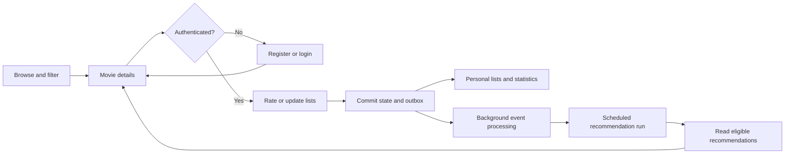

# User journeys

Status: proposed Phase 0 behavior. Each journey references acceptance requirements.

## Discover and establish an account

1. A visitor opens the catalog, searches by title and combines genre/year filters (FR-03).
2. They open active movie details. Missing/inactive movies show an unavailable state (FR-04).
3. A save/rate action directs an anonymous visitor to login/register, preserving an internal return path. Reject external redirect URLs.
4. Registration validates input, creates USER and returns to the intended movie after authentication (FR-01). Duplicate email or invalid credentials display safe errors; rate limits show retry guidance.
5. Session refresh runs once across concurrent requests; expired/revoked sessions return to login without discarding unsent form input (FR-02).

## Record preferences and organize movies

1. An authenticated user opens a movie; the client posts a deduplicated view UUID independently of the detail read.
2. They rate it 1–5 or remove a rating, and independently toggle watched, favorite or watchlist status (FR-05/06).
3. API success means state and its event are committed. The UI confirms server state and invalidates affected queries.
4. If a request fails, optimistic UI rolls back and offers retry. Collection retries reuse the same desired state; view retries reuse the same UUID.
5. Personal lists and statistics reflect committed PostgreSQL state immediately. Background projections may lag; their freshness is displayed where used (FR-07/09).

## Receive recommendations

1. A new user opens recommendations and receives popularity or explicitly labeled catalog fallback (FR-08).
2. After enough real ratings, a later successful run may produce collaborative predictions. UI displays generation time and recommendation method without promising immediate personalization.
3. Watched/rated/inactive movies are removed at response time even if the stored run predates the change.
4. Empty eligible catalog shows an honest empty state. Worker failure preserves previous results with age/fallback information; retrying the page does not launch expensive recomputation.

## Admin catalog and users

1. ADMIN opens the authorized management UI and creates/edits movies and assigns existing or new genres (FR-10).
2. Invalid fields fail validation; stale resource versions produce a conflict and prompt reload.
3. Deactivation removes a movie from public discovery and recommendation responses while retaining history.
4. ADMIN lists users and changes status/role. Last-active-admin protection and self-change restrictions are enforced transactionally (FR-11).
5. Suspension revokes sessions. Every administrative mutation records an audit entry; failures roll back audit and business changes together.

## Admin processing recovery

1. ADMIN sees backlog age, pending/retry/quarantine counts and worker heartbeat (FR-12/13).
2. They inspect a sanitized failure, fix the cause through a separately authorized operational change, and request replay.
3. API records an audited durable replay job and returns its ID; UI polls status. A replay request is not evidence of successful processing.
4. Worker reuses the original event UUID. Successful processing commits a receipt and clears unresolved failure state before acknowledgement; duplicates remain safe no-ops.
5. ADMIN inspects recommendation runs and requests a coalesced regeneration job. Failure shows a safe reason and retains the previous active run (FR-14).

